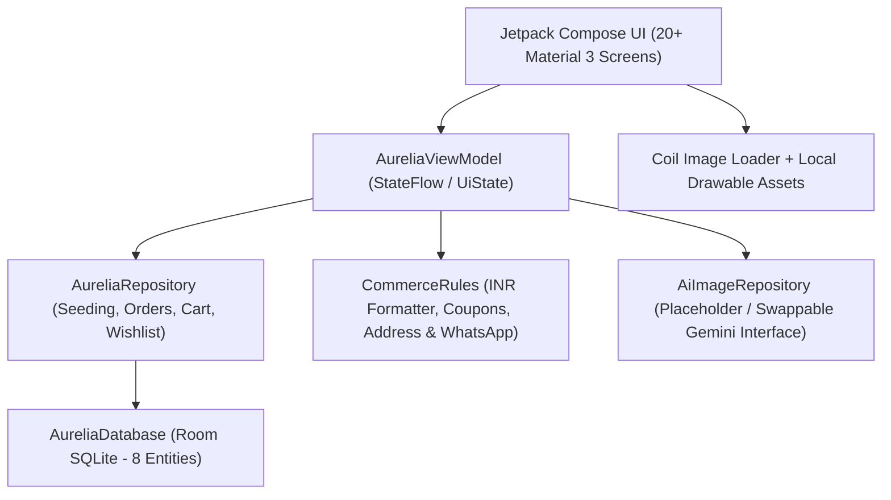

<p align="center">
  
</p>

<h1 align="center">Aurelia Jewels</h1>

<p align="center">
  <strong>Luxury Indian Fine Jewellery Android Application</strong><br />
  Built with Kotlin, Jetpack Compose, Material Design 3, and Room SQLite
</p>

<p align="center">
  
  
  
  
  
</p>

---

## Overview

**Aurelia Jewels** is a native Android luxury jewellery commerce prototype designed around a warm editorial Indian heritage aesthetic. The application delivers a complete end-to-end shopping experience with offline-first Room SQLite persistence, adaptive layouts, INR currency formatting, filterable luxury product grids, wishlist management, 3-step guest checkout, WhatsApp order inquiry handoff, and an in-app Admin Design Studio.

### Visual Identity & Brand Palette

| Role | Token | Hex | Usage |
| :--- | :--- | :--- | :--- |
| Canvas Background | Warm Ivory | `#FAF7F2` | Primary screen background across all flows |
| Secondary Surface | Soft Cream | `#F3EDE5` | Product cards, summary panels, filter sheets |
| Subtle Hairline / Tint | Champagne | `#EADCC9` | Borders, dividers, inactive chip surfaces |
| Luxury Accent | Muted Antique Gold | `#AD853C` | Highlights, ratings, active badges, emblem |
| Primary Action | Deep Forest Olive | `#27351A` | Primary CTA buttons, selected filter chips |

Typography pairs **Cormorant Garamond** (editorial serif headings and wordmark) with **DM Sans** (clean UI controls, pricing, and metadata), bundled locally in `app/src/main/res/font/`.

---

## App UI Showcase & Visual Assets

### 12-Screen Luxury UI Design Showcase

> *Note: The showcase board below presents the 12-screen Aurelia Jewels design system and user journey (Splash, Onboarding, Home, Categories, Product Grid, Product Detail, Cart, Checkout, Payment, Order Tracking, Account, and Notifications). Real device screenshots can be added under `docs/screenshots/` after installing the APK.*

<p align="center">
  
</p>

### Bundled In-App Studio Photography

These high-resolution assets are packaged directly inside `app/src/main/res/drawable/` and rendered in the app with metal-specific visual styling:

| Bridal Hero Banner | Gold Ring | Gold Necklace | Jhumka Earrings | Gold Bangle |
| :---: | :---: | :---: | :---: | :---: |
|  |  |  |  |  |

---

## Complete Feature & Screen Map

The application includes **20+ functional Jetpack Compose screens** wired via Navigation Compose in `MainActivity.kt`:

| Module | Screens & Capabilities | Source File |
| :--- | :--- | :--- |
| **Entry Flow** | Branded Splash Screen with lotus emblem & multi-page Luxury Onboarding | `ui/screens/SplashAndOnboardingScreens.kt` |
| **Discovery Home** | Search bar, Bridal Hero Carousel, Trust Strip, Category Grid, Featured & Trending rails, WhatsApp Concierge CTA | `ui/screens/HomeScreen.kt` |
| **Luxury Jewellery Grid** | Adaptive `LazyVerticalGrid`, Top Bar + ModalBottomSheet **Filter** (Category, Material, Price Range, Saved Only, In Stock), **Sort** sheet, and **Room-persisted Wishlist hearts** | `ui/screens/LuxuryJewelleryGridScreen.kt` |
| **Catalogue & Search** | 12-Category directory, category listing, instant live search, and persisted recent searches | `ui/screens/CatalogueAndSearchScreens.kt` |
| **Product Detail** | Full gallery, purity & weight specs, dynamic size selector (ring/bangle/chain), wishlist toggle, Add to Bag, Buy Now, WhatsApp product inquiry | `ui/screens/ProductDetailScreen.kt` |
| **Wishlist & Shopping Bag** | Saved Room collection with move-to-bag, cart quantity stepper, coupon engine (`AURELIA10`, `HERITAGE5`), live INR price breakdown | `ui/screens/WishlistAndBagScreens.kt` |
| **Checkout & Orders** | 3-step Guest Checkout (Address with 10-digit Indian mobile & 6-digit PIN validation, Delivery mode, Order Review), Simulated Demo Payment, Order Success, Order History, and 5-stage Order Tracking | `ui/screens/CheckoutAndOrdersScreens.kt` |
| **Customer & Guides** | Account hub, Notification center, Contact & Support (Call / Email / WhatsApp), Jewellery Care & Sizing Guide, Demo Reference Gold Rates | `ui/screens/CustomerScreens.kt` |
| **Admin Design Studio** | In-app Catalogue CRUD (Add/Edit/Delete products with Android Photo Picker), live Brand Theme Hex customizer, Demo Order stage simulator, Reset-to-Defaults, and Bespoke AI Concept Studio (`1K` / `2K` / `4K` selector) | `ui/screens/DesignStudioScreens.kt` |

---

## Architecture

Aurelia Jewels follows unidirectional **MVVM** with reactive Kotlin `Flow` / `StateFlow` pipelines backed by local **Room SQLite** persistence.



### Room SQLite Persistence (`aurelia_jewels_demo.db`)

All user state persists across app restarts via 8 Room entities registered in `AureliaDatabase.kt`:

1. `products` (`Product`) — 29 pre-seeded Indian fine jewellery items across 12 categories and 5 materials (`22K Gold`, `18K Gold`, `Diamond`, `925 Silver`, `Polki / Kundan`).
2. `wishlist` (`WishlistEntity`) — User's hearted luxury pieces synced in real time across Home, Grid, Detail, and Wishlist screens.
3. `cart_items` (`CartItemEntity`) — Selected item quantities and category-specific sizes.
4. `addresses` (`AddressEntity`) — Saved Indian delivery addresses with PIN and phone validation.
5. `orders` (`OrderEntity`) — Immutable JSON order snapshots with trackable demo stages.
6. `notifications` (`NotificationEntity`) — Seeded and order-triggered alerts.
7. `recent_searches` (`RecentSearchEntity`) — Persisted search history.
8. `store_config` (`StoreConfigEntity`) — Custom brand colors, WhatsApp number, and Studio settings.

---

## Get the APK Automatically via GitHub Actions (No Android Studio Needed)

This repository includes a pre-configured workflow at `.github/workflows/build-android-apk.yml` that builds and tests the Android APK automatically in the cloud.

### Step-by-Step Instructions

1. Push this project to your GitHub repository (from Google AI Studio via **Export / Push to GitHub**, or manually via Git).
2. Open your repository on GitHub and click the **Actions** tab at the top.
3. Click the latest **Build Aurelia Jewels Android APK** workflow run (wait 2-4 minutes for the green checkmark).
4. Scroll down to **Artifacts** and click **Aurelia-Jewels-APK** to download the zip containing `Aurelia-Jewels-debug.apk`.
5. Unzip once and share `Aurelia-Jewels-debug.apk` with your client via WhatsApp (as a **Document**) or Google Drive.

### Optional: One-Click Direct APK Download Link (GitHub Release)

To generate a direct `.apk` download link (no zip extraction needed):

1. Go to **Actions** -> **Build Aurelia Jewels Android APK** -> click **Run workflow**.
2. Check **Create a GitHub Release with direct APK download link**.
3. Click **Run workflow**. Once finished, open the **Releases** section on the right sidebar of your repo to copy the direct `Aurelia-Jewels-debug.apk` link.

For a client-ready installation checklist and WhatsApp message template, see [`docs/CLIENT_HANDOFF.md`](docs/CLIENT_HANDOFF.md).

---

## Prerequisites for Android Development

Before cloning or building the project locally, make sure your machine has:

- **Android Studio**: Meerkat / Narwhal or newer (supporting **AGP 9.1.1** and **Gradle 9.3.1**)
- **Java Development Kit (JDK)**: **JDK 21** (Temurin / OpenJDK 21 recommended)
- **Android SDK Components** (installable via Android Studio -> **Settings -> Languages & Frameworks -> Android SDK**):
  - Android SDK Platform **API 36** (`compileSdk 36`, `minorApiLevel = 1`)
  - Android SDK Build-Tools **36.x**
  - Android SDK Platform-Tools
- **Git**: Installed and configured for cloning the repository
- **Test Target**: Either an Android Virtual Device (AVD, API 24+) or a physical Android phone running Android 7.0 (API 24) or higher with **USB Debugging** enabled

---

## Cloning and Setting Up the Project in Android Studio

Follow these steps to open and configure **Aurelia Jewels** in Android Studio:

1. **Clone the repository**
   ```bash
   git clone https://github.com/<your-username>/<your-repo-name>.git
   cd <your-repo-name>
   ```

2. **Restore the Debug Keystore (Required Once)**
   `app/build.gradle.kts` signs debug builds using `${rootDir}/debug.keystore`. That binary file is excluded by `.gitignore`, while `debug.keystore.base64` is tracked in the repository. Run one of the commands below in the project root:
   ```bash
   # macOS / Linux / Git Bash
   base64 -d debug.keystore.base64 > debug.keystore

   # Windows PowerShell
   [IO.File]::WriteAllBytes("debug.keystore", [Convert]::FromBase64String((Get-Content -Raw "debug.keystore.base64")))
   ```

3. **Optional Environment File (`.env`)**
   The Secrets Gradle Plugin reads `.env` and automatically falls back to `.env.example`, so no API key is required to run the app. If you add custom third-party keys later, copy `.env.example` to `.env` (already ignored in `.gitignore`).

4. **Open in Android Studio**
   - Launch Android Studio and select **Open**.
   - Choose the cloned root directory (containing `settings.gradle.kts`).
   - Verify the Gradle JDK is set to **JDK 21** (**Settings -> Build, Execution, Deployment -> Build Tools -> Gradle -> Gradle JDK**).
   - Wait for **Gradle Sync** to finish downloading dependencies (Jetpack Compose, Room, KSP, Coil, Navigation Compose).

5. **Run on Device or Emulator**
   - Connect an Android phone via USB (or start an AVD), select the `app` run configuration, and click **Run** (`Shift + F10` / `Ctrl + R`).

---

## Building and Generating the APK (Build Menu & CLI)

### Method 1: Android Studio Build Menu (Recommended for GUI Users)

1. Wait until Gradle Sync completes with zero errors.
2. In the top menu bar, click **Build -> Build Bundle(s) / APK(s) -> Build APK(s)**.
3. Wait 1-3 minutes while Gradle compiles Kotlin sources, runs KSP for Room, and packages resources.
4. When the **"APK(s) generated successfully"** notification appears at the bottom-right corner, click **locate**.
5. Android Studio will open the output folder containing your installable APK:
   ```text
   app/build/outputs/apk/debug/app-debug.apk
   ```
6. Copy `app-debug.apk` to your Android phone (via USB cable, Google Drive, or WhatsApp as a **Document**), tap it on your phone, allow **Install unknown apps** if prompted, and tap **Install**.

> *Note: Always distribute `.apk` for direct phone installation. `.aab` (Android App Bundle) files are only for Google Play Console uploads and cannot be installed directly on Android phones.*

### Method 2: Command Line (Gradle CLI)

```bash
# Run JVM unit tests (INR formatter, coupons, checkout validation, grid filters)
gradle :app:testDebugUnitTest

# Assemble installable Debug APK
gradle :app:assembleDebug
```

Output APK location:

```text
app/build/outputs/apk/debug/app-debug.apk
```

---

## Connecting Firebase in the Future (Optional)

Currently, **Aurelia Jewels** runs 100% offline using local **Room SQLite** storage (`aurelia_jewels_demo.db`) and a placeholder implementation (`PlaceholderAiImageRepository`) for the Bespoke AI Concept Studio. If you decide to enable cloud sync (Firestore), user login (Firebase Auth), or live Gemini image generation (Firebase AI Logic) later, follow these steps:

1. **Create a Firebase Project**
   - Open the [Firebase Console](https://console.firebase.google.com/) and create a new project.
   - Click **Add app -> Android**.
   - Enter the exact package name from `app/build.gradle.kts`:
     ```text
     com.aistudio.aureliajewels.kxmprq
     ```
   - *(Required for Google Sign-In & App Check)* Add your debug/release **SHA-1** and **SHA-256** signing fingerprints (viewable via `keytool -list -v -keystore debug.keystore -alias androiddebugkey -storepass android`).

2. **Add `google-services.json`**
   - Download `google-services.json` from Firebase Console and place it inside the `app/` directory (`app/google-services.json`).
   - The `com.google.gms.google-services` plugin is already declared in `app/build.gradle.kts` and configured to pass through safely when absent.

3. **Uncomment Pre-Configured Firebase Dependencies**
   Open `app/build.gradle.kts` and uncomment only the modules you need from the existing catalog entries:
   - **Core BoM (required for all Firebase libraries):** `implementation(platform(libs.firebase.bom))`
   - **Firebase AI Logic (live `gemini-3-pro-image-preview` image generation):** `implementation(libs.firebase.ai)` plus `libs.firebase.appcheck.debug` / `libs.firebase.appcheck.recaptcha`
   - **Cloud Firestore (multi-device sync):** `implementation(libs.firebase.firestore)`
   - **Google Sign-In via Credential Manager:** uncomment `libs.firebase.auth`, `libs.androidx.credentials`, `libs.androidx.credentials.play.services`, and `libs.googleid` together

4. **Swap the AI Repository Implementation**
   - Replace `PlaceholderAiImageRepository` in `app/src/main/java/com/example/data/AiImageRepository.kt` with a `Firebase.ai.generativeModel(...)` implementation targeting `gemini-3-pro-image-preview`.
   - Enable **Firebase AI Logic** and **App Check** in the Firebase Console before testing on device.
   - *(If using Google AI Studio)* You can also provision Firebase directly from AI Studio without manually downloading `google-services.json`.

5. **Security Best Practices**
   - Never hardcode API keys or server secrets in Kotlin source files.
   - Configure strict Firestore Security Rules before storing real customer orders or addresses.
   - Keep `.env` and private release keystores (`.jks`) out of version control (already enforced by `.gitignore`).

---

## Tech Stack & Dependencies

| Component | Library / Version |
| :--- | :--- |
| Application ID | `com.aistudio.aureliajewels.kxmprq` |
| Min / Target / Compile SDK | `24` / `36` / `36 (minorApiLevel = 1)` |
| Android Gradle Plugin | `9.1.1` |
| Gradle | `9.3.1` |
| Kotlin | `2.4.21` |
| Jetpack Compose BOM | `2024.09.00` (Material 3 + Material Icons Extended) |
| Navigation Compose | `2.8.9` |
| Room Database + KSP | `2.7.0` + KSP `2.3.5` |
| Image Loading | Coil Compose `2.7.0` |
| Concurrency | Kotlinx Coroutines `1.10.2` |
| Testing | JUnit `4.13.2`, Robolectric `4.16.1`, Coroutines Test `1.10.2` |

---

## Project Structure

```text
.
├── .github/
│   └── workflows/
│       └── build-android-apk.yml          # Automated unit tests, Debug APK artifact & optional Release
├── docs/
│   ├── CLIENT_HANDOFF.md                  # Non-developer APK export & client delivery guide
│   └── screenshots/
│       └── README.md                      # Guide for adding live device screenshots
├── app/
│   ├── build.gradle.kts                   # Module build config, dependencies & signingConfigs
│   └── src/
│       ├── main/
│       │   ├── AndroidManifest.xml        # WhatsApp/Dial/Mail queries & MainActivity
│       │   ├── java/com/example/
│       │   │   ├── MainActivity.kt        # NavHost & root Compose scaffold
│       │   │   ├── data/
│       │   │   │   ├── AiImageRepository.kt
│       │   │   │   ├── AureliaRepository.kt
│       │   │   │   ├── SeedData.kt        # 29 seeded Indian jewellery products
│       │   │   │   └── local/             # Product, Entities, Daos, AureliaDatabase
│       │   │   ├── domain/
│       │   │   │   └── CommerceRules.kt   # INR formatting, coupons, validators, WhatsApp text
│       │   │   └── ui/
│       │   │       ├── AureliaViewModel.kt
│       │   │       ├── components/        # Reusable M3 luxury cards, bars & photo renderer
│       │   │       ├── screens/           # 9 screen files covering 20+ app views
│       │   │       └── theme/             # Color.kt, Type.kt, Theme.kt
│       │   └── res/
│       │       ├── drawable/              # Custom adaptive logo + 5 studio jewellery photos
│       │       ├── font/                  # Cormorant Garamond & DM Sans (.ttf)
│       │       └── values/                # strings.xml, colors.xml, themes.xml
│       └── test/java/com/example/
│           └── AureliaCommerceRulesTest.kt # 8 verified JVM unit tests
├── gradle/
│   ├── libs.versions.toml                 # Centralized Version Catalog
│   └── wrapper/gradle-wrapper.properties  # Gradle 9.3.1 distribution config
├── public/assets/aistudio/
│   └── Aurelia_Jewels_Luxury_App_Showcase_a3e5fbb6.png
├── debug.keystore.base64                  # Base64-encoded debug signing key for CI & local builds
├── .env.example                           # Secrets plugin placeholder
├── build.gradle.kts
├── gradle.properties
└── settings.gradle.kts
```

---

## Demo Scope & Transparent Disclosures

- **Local Persistence Only**: All catalogue data, wishlist items, shopping bag contents, addresses, and orders are stored on-device using Room SQLite (`aurelia_jewels_demo.db`). No backend server or user account login is required for demo walkthroughs.
- **Simulated Payments & Demo Gold Rates**: Payment screens simulate checkout confirmation for presentation purposes only; no real payment gateway or financial transaction is executed. Gold rate cards are labeled as demo reference rates.
- **Bespoke AI Concept Studio**: Live cloud image generation via Firebase AI Logic (`gemini-3-pro-image-preview`) is decoupled behind `AiImageRepository` and currently uses `PlaceholderAiImageRepository` with clearly labeled sample concepts because Firebase setup was not provisioned.
- **WhatsApp Handoff**: Order summaries and product inquiries compose real pre-filled WhatsApp intents (`https://wa.me/...`) using the configured concierge number in Store Settings.
