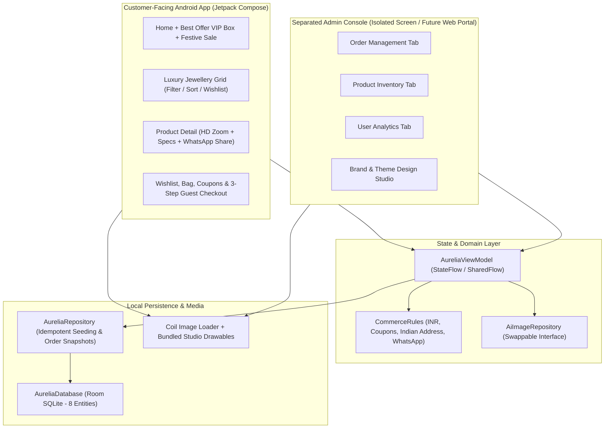
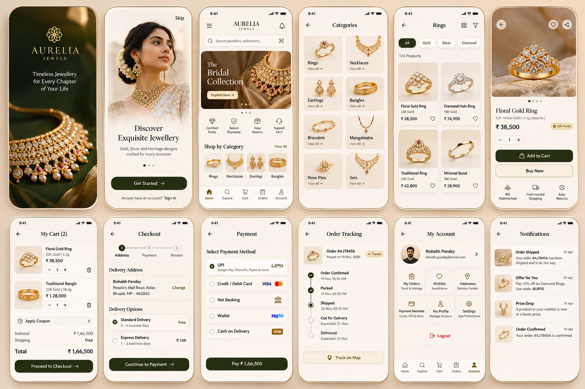
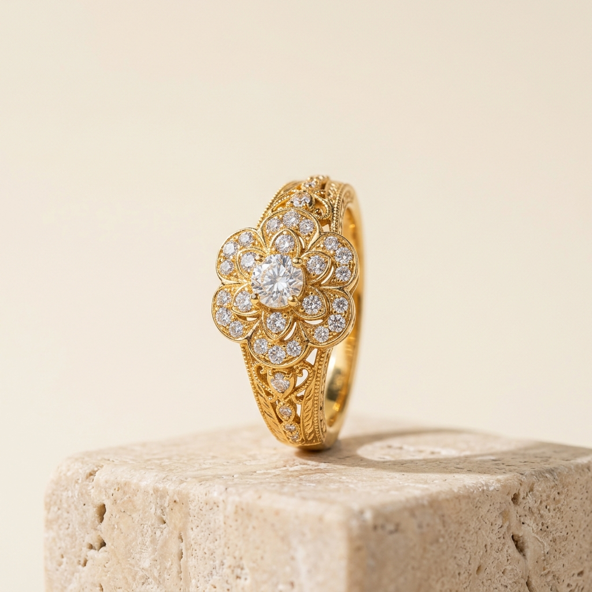
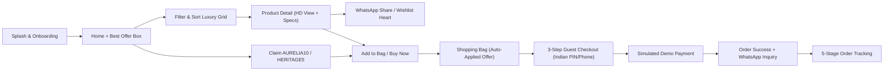
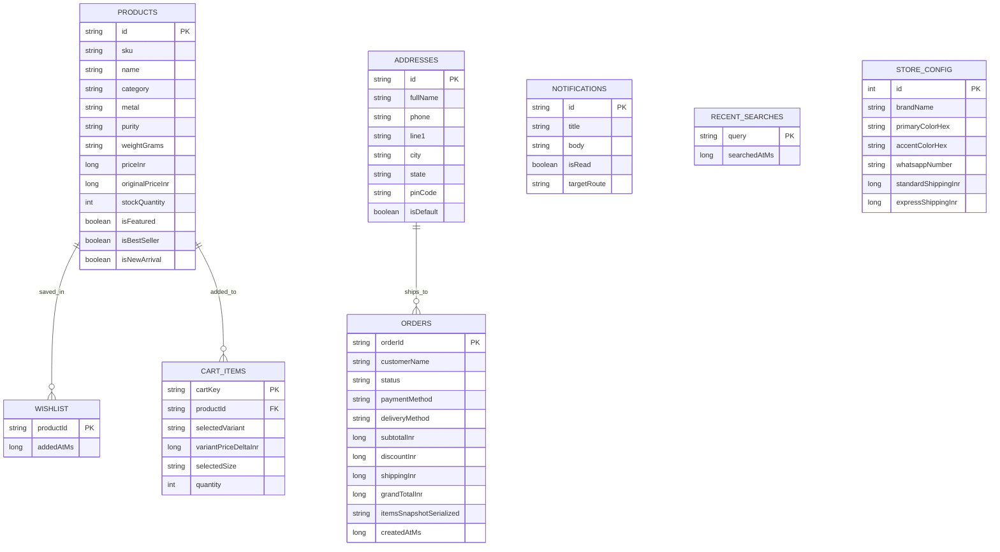
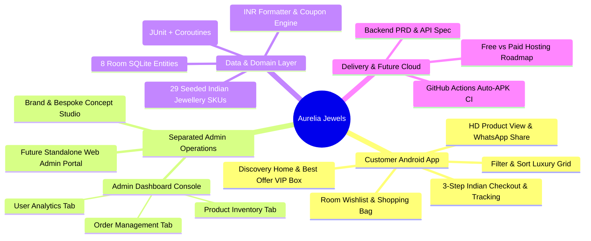
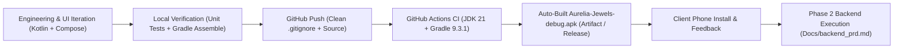

<p align="center">
  
</p>

<h1 align="center">Aurelia Jewels</h1>

<p align="center">
  <strong>Luxury Indian Fine Jewellery Android Application &amp; Operations Architecture</strong><br />
  Native Kotlin, Jetpack Compose, Material Design 3, Room SQLite &amp; Automated GitHub Actions APK CI
</p>

<p align="center">
  
  
  
  
  
</p>

---

## 1. Project Overview

**Aurelia Jewels** (`com.aistudio.aureliajewels.kxmprq`) is a native Android luxury Indian jewellery shopping application engineered around a warm editorial heritage aesthetic. The application delivers an offline-first commerce experience powered by **Room SQLite**, adaptive Material 3 layouts, Indian numbering INR currency formatting, an animated metallic gold foil **Best Offer & Festive Sale** showcase, filterable luxury product grids, high-resolution product detail views with **WhatsApp Share**, persistent wishlist and bag management, 3-step guest checkout, and a cleanly separated **Admin Dashboard** (`Order Management`, `Product Inventory`, and `User Analytics`).

### Visual Identity & Design Tokens

| Role | Token | Hex | Usage |
| :--- | :--- | :--- | :--- |
| Canvas Background | Warm Ivory | `#FAF7F2` | Primary screen canvas across customer and admin surfaces |
| Secondary Surface | Soft Cream | `#F3EDE5` | Product cards, specification panels, filter sheets |
| Subtle Hairline / Tint | Champagne | `#EADCC9` | Borders, dividers, subtle tags |
| Luxury Accent | Muted Antique Gold | `#AD853C` | Highlights, emblems, active accent labels |
| Metallic Shimmer CTA | Gold Foil Gradient | `#BF953F -> #FCF6BA -> #B38728 -> #AA771C` | Animated Crown "Claim Offer" pill button |
| Primary Action | Deep Forest Olive | `#27351A` | Primary buttons, Best Offer VIP box, selected chips |

Typography pairs **Cormorant Garamond** (editorial serif headings and wordmark) with **DM Sans** (crisp UI labels, specifications, and pricing), bundled locally in `app/src/main/res/font/`.

---

## 2. System Architecture & Infographics

### 2.1 Layered Android & Future Cloud Separation Architecture



### 2.2 Production Target Topology (Customer APK vs. Standalone Admin Web Portal)

```text
┌─────────────────────────────────────┐      ┌─────────────────────────────────────┐
│  Aurelia Jewels Android APK         │      │  Standalone Admin Web Portal        │
│  (Customer-Only Production Build)   │      │  (admin.aureliajewels.in on Vercel) │
│  • Guest Browse + Room Cache        │      │  • Separate Admin Login + 2FA       │
│  • Auth, Wishlist, Bag, Checkout    │      │  • Order Management & Refund Queue  │
│  • UPI / Card Checkout SDK          │      │  • Product Inventory & Gold Rates   │
└──────────────────┬──────────────────┘      └──────────────────┬──────────────────┘
                   │ Customer JWT                               │ Admin JWT (RBAC)
                   └──────────────────────┬─────────────────────┘
                                          ▼
                   ┌────────────────────────────────────────────┐
                   │   Server-Side API & Security Boundary      │
                   │   (Supabase / Firebase / Hostinger VPS)    │
                   └────────────────────────────────────────────┘
```

---

## 3. Visual Showcase Gallery

### 3.1 12-Screen Luxury UI Design Showcase

> *Transparency note: The board below presents the 12-screen Aurelia Jewels design system and core shopping journey. Live physical-device captures can be added to [`docs/screenshots/`](docs/screenshots/README.md) after installing the APK on an Android phone.*

<p align="center">
  
</p>

### 3.2 Bundled In-App Studio Photography & Brand Assets

All 6 visual assets below are bundled inside `app/src/main/res/drawable/` and rendered live inside the app with photographic metal-finish grading:

| App Emblem | Bridal Hero Banner | Gold Ring | Gold Necklace | Jhumka Earrings | Gold Bangle |
| :---: | :---: | :---: | :---: | :---: | :---: |
|  |  |  |  |  |  |

---

## 4. Public Modules & Feature Matrix

### 4.1 Customer-Facing Modules

| Module | Key Screens & Capabilities | Source File |
| :--- | :--- | :--- |
| **Entry & Onboarding** | Branded Splash with lotus emblem + multi-page editorial onboarding | `ui/screens/SplashAndOnboardingScreens.kt` |
| **Discovery Home & Offers** | Search bar, Quick-Access pills, Hero Carousel, **Best Offer VIP Box** with animated metallic gold Crown **"CLAIM OFFER"** button & live daily countdown, **Festive Sale Picks** carousel, Categories, Metals, Occasions, Demo Gold Rates | `ui/screens/HomeScreen.kt` |
| **Luxury Jewellery Grid** | Adaptive `LazyVerticalGrid`, Top Bar & ModalBottomSheet **Filter** (Category, Material, Price Range, Saved Only, In Stock), **Sort** sheet, `SAVE X%` tags, Room-persisted Wishlist hearts | `ui/screens/LuxuryJewelleryGridScreen.kt` |
| **Detailed Product View** | Swipeable gallery + **HD Fullscreen Zoom Viewer**, variant & dynamic size selectors, full description, structured **Material Specifications** table, **WhatsApp Share** button, Add to Bag, Buy Now | `ui/screens/ProductDetailScreen.kt` |
| **Catalogue & Live Search** | 12-category directory, category/metal/occasion listing, live search & persisted recent searches | `ui/screens/CatalogueAndSearchScreens.kt` |
| **Wishlist & Shopping Bag** | Room-saved collection, quantity stepper, promo engine (`AURELIA10` / `HERITAGE5`) with 1-tap Gold Shimmer Claim CTA, INR breakdown | `ui/screens/WishlistAndBagScreens.kt` |
| **Checkout & Order Tracking** | 3-step guest checkout (validated Indian mobile + 6-digit PIN), simulated demo payment, Order Success, Order History, 5-stage Order Tracking, WhatsApp order summary | `ui/screens/CheckoutAndOrdersScreens.kt` |
| **Account, Guides & Concierge** | Account hub, Notification center, Call/Email/WhatsApp support, Jewellery Sizing & Care Guide, Demo Gold Rates | `ui/screens/CustomerScreens.kt` |

### 4.2 Separated Admin & Studio Modules

| Module | Dedicated Capabilities | Source File |
| :--- | :--- | :--- |
| **Admin Dashboard (Separated)** | 3 isolated tabs: **Order Management** (KPIs + 1-tap Advance Stage), **Product Inventory** (SKU search, Low/Out/Sale filters, live `+/-` Room stock stepper, delete confirmation), **User Analytics** (live Room funnel metrics, Metal distribution bars, Top Categories table) | `ui/screens/AdminDashboardScreen.kt` |
| **Brand & Bespoke Studio** | Catalogue CRUD with Android Photo Picker, live Brand Hex Color customizer, Demo Reset, Bespoke AI Concept Studio (`1K` / `2K` / `4K` selector) | `ui/screens/DesignStudioScreens.kt` |

---

## 5. Product Flow



---

## 6. Relational Data Schema & Entity Model (ERD)

All 8 entities below are registered in `AureliaDatabase.kt` (`aurelia_jewels_demo.db`, Room 2.7.0):



---

## 7. Mind Map



---

## 8. Team Flow



---

## 9. Project Structure

```text
.
├── .github/
│   └── workflows/
│       └── build-android-apk.yml          # Automated unit tests, Debug APK artifact & optional Release
├── Docs/
│   ├── backend_prd.md                     # Architecture PRD, Admin separation, SQL schema & API contracts
│   └── hosting_guide.md                   # Free testing vs paid production hosting comparison
├── docs/
│   ├── CLIENT_HANDOFF.md                  # Non-developer APK export & client delivery guide
│   ├── backend/                           # Deep-dive backend pack (INDEX, PRD, Hosting, Admin, API/DB)
│   └── screenshots/
│       └── README.md                      # Guide for adding live device screenshots
├── app/
│   ├── build.gradle.kts                   # Module build config, dependencies & signingConfigs
│   └── src/
│       ├── main/
│       │   ├── AndroidManifest.xml        # WhatsApp/Dial/Mail queries & MainActivity
│       │   ├── java/com/example/
│       │   │   ├── MainActivity.kt        # NavHost & root Compose scaffold
│       │   │   ├── data/
│       │   │   │   ├── AiImageRepository.kt
│       │   │   │   ├── AureliaRepository.kt
│       │   │   │   ├── SeedData.kt        # 29 seeded Indian jewellery products
│       │   │   │   └── local/             # Product, Entities, Daos, AureliaDatabase
│       │   │   ├── domain/
│       │   │   │   └── CommerceRules.kt   # INR formatting, coupons, validators, WhatsApp text
│       │   │   └── ui/
│       │   │       ├── AureliaViewModel.kt
│       │   │       ├── components/        # GoldShimmerClaimButton, RoyalCrownIcon, M3 cards & bars
│       │   │       ├── screens/           # 10 screen files (Customer UI + AdminDashboardScreen)
│       │   │       └── theme/             # Color.kt, Type.kt, Theme.kt
│       │   └── res/
│       │       ├── drawable/              # Custom adaptive logo + 5 studio jewellery photos
│       │       ├── font/                  # Cormorant Garamond & DM Sans (.ttf)
│       │       └── values/                # strings.xml, colors.xml, themes.xml
│       └── test/java/com/example/
│           └── AureliaCommerceRulesTest.kt # 8 verified JVM unit tests
├── gradle/
│   ├── libs.versions.toml                 # Centralized Version Catalog
│   └── wrapper/gradle-wrapper.properties  # Gradle 9.3.1 distribution config
├── public/assets/aistudio/
│   └── Aurelia_Jewels_Luxury_App_Showcase_a3e5fbb6.png
├── debug.keystore.base64                  # Base64-encoded debug signing key for CI & local builds
├── .env.example                           # Secrets plugin placeholder
├── .gitignore                             # Standard Android ignore rules
├── build.gradle.kts
├── gradle.properties
└── settings.gradle.kts
```

---

## 10. Get the APK Automatically via GitHub Actions (No Android Studio Needed)

This repository includes `.github/workflows/build-android-apk.yml` to compile and test the Android APK automatically in the cloud:

1. Push this project to your GitHub repository.
2. Open the **Actions** tab -> click the latest **Build Aurelia Jewels Android APK** run (2-4 minutes).
3. Scroll down to **Artifacts** -> download **Aurelia-Jewels-APK** and unzip `Aurelia-Jewels-debug.apk`.
4. *(Direct APK Link Option)* Open **Actions -> Build Aurelia Jewels Android APK -> Run workflow**, tick **Create a GitHub Release with direct APK download link**, and run — the direct `.apk` link appears under **Releases**.

---

## 11. Prerequisites for Android Development

- **Android Studio**: Meerkat / Narwhal or newer (supporting **AGP 9.1.1** and **Gradle 9.3.1**)
- **Java Development Kit (JDK)**: **JDK 21** (Temurin / OpenJDK 21 recommended)
- **Android SDK Components**: Platform **API 36** (`compileSdk 36`, `minorApiLevel = 1`), Build-Tools **36.x**, Platform-Tools
- **Git** and an Android physical phone (API 24+) or AVD emulator

---

## 12. Cloning, Setting Up & Building the APK in Android Studio

1. **Clone the repository**
   ```bash
   git clone https://github.com/<your-username>/<your-repo-name>.git
   cd <your-repo-name>
   ```
2. **Decode the Debug Keystore once** (`debug.keystore` is gitignored; `debug.keystore.base64` is tracked):
   ```bash
   # macOS / Linux / Git Bash
   base64 -d debug.keystore.base64 > debug.keystore

   # Windows PowerShell
   [IO.File]::WriteAllBytes("debug.keystore", [Convert]::FromBase64String((Get-Content -Raw "debug.keystore.base64")))
   ```
3. **Open in Android Studio** -> select the root folder -> verify Gradle JDK is **JDK 21** -> wait for Gradle Sync.
4. **Generate the APK via Build Menu**:
   - Top menu: **Build -> Build Bundle(s) / APK(s) -> Build APK(s)**.
   - Click **locate** when complete to open `app/build/outputs/apk/debug/app-debug.apk`.
5. **CLI Equivalent**:
   ```bash
   gradle :app:testDebugUnitTest
   gradle :app:assembleDebug
   ```

---

## 13. Connecting Firebase in the Future (Optional)

When moving from the offline Room demo to live Firebase cloud sync or Gemini AI image generation:

1. Create a project in [Firebase Console](https://console.firebase.google.com/) and add an Android app using package name `com.aistudio.aureliajewels.kxmprq` + your SHA-1/SHA-256 keystore fingerprints.
2. Place `google-services.json` inside `app/`.
3. Uncomment the pre-configured dependencies in `app/build.gradle.kts` (`firebase-bom`, `firebase-ai`, `firebase-firestore`, `firebase-auth`, `credentials`, `firebase-appcheck-*`).
4. Swap `PlaceholderAiImageRepository` in `AiImageRepository.kt` with a `Firebase.ai.generativeModel(...)` implementation targeting `gemini-3-pro-image-preview`.
5. For full SQL vs. Firebase trade-offs and strict standalone Admin separation, see [`Docs/backend_prd.md`](Docs/backend_prd.md) and [`Docs/hosting_guide.md`](Docs/hosting_guide.md).

---

## 14. Non-Negotiables

- **Brand Restraint**: Strictly warm luxury Indian editorial palette (`#FAF7F2`, `#F3EDE5`, `#EADCC9`, `#AD853C`, `#27351A`). No neon, no purple slop, no emojis in UI or docs.
- **Strict Customer vs. Admin Separation**: Production deployments must isolate store administration into a standalone web portal with server-side RBAC — never trust client-side role checks or client-supplied prices.
- **Zero Hardcoded Secrets**: Never commit `.env`, API keys, or release `.jks` keystores to Git (enforced by `.gitignore`).
- **Honest Demo Boundaries**: Never claim live payment collection, BIS hallmark certification, or live bullion feeds in an offline prototype.
- **Verified Engineering**: Every change compiles via Gradle and preserves unit test coverage (`AureliaCommerceRulesTest`).

---

## 15. Current Limits (Do Not Overclaim)

| Area | Current Verified State | What Is Required for Production |
| :--- | :--- | :--- |
| **Database & Sync** | Local on-device Room SQLite (`aurelia_jewels_demo.db`) | Provision cloud backend per [`Docs/backend_prd.md`](Docs/backend_prd.md) |
| **Payments** | Simulated demo checkout confirmation only | Integrate Razorpay / Cashfree with server-verified HMAC webhooks |
| **Admin Separation** | Isolated in-app `AdminDashboardScreen` for demo review | Disable demo admin flag in Play Store builds; deploy standalone web admin portal |
| **Gold Rates** | Illustrative static demo reference figures | Connect Admin-updated `gold_rates` table or licensed bullion API |
| **Bespoke AI Studio** | Clearly labeled placeholder concepts (`PlaceholderAiImageRepository`) | Provision Firebase AI Logic + App Check + per-user daily caps |
| **Visual Captures** | 12-screen UI Showcase + 6 bundled drawables verified in repo | Capture live phone screenshots after APK install and place in `docs/screenshots/` |
| **GitHub Actions CI** | Workflow YAML prepared with JDK 21 + Gradle 9.3.1 + keystore decode | Verify first live cloud build run after pushing to GitHub |

---

## 16. Documentation Map

| Document | Description |
| :--- | :--- |
| [`README.md`](README.md) | Master project overview, architecture, setup, APK build & attribution |
| [`Docs/backend_prd.md`](Docs/backend_prd.md) | Backend architecture PRD, Customer vs. Admin separation, portable SQL schema & API contracts |
| [`Docs/hosting_guide.md`](Docs/hosting_guide.md) | Free testing stacks (Firebase / Supabase / Vercel) vs. paid production hosting (Hostinger VPS / Pro tiers) |
| [`docs/backend/INDEX.md`](docs/backend/INDEX.md) | Deep-dive backend documentation index |
| [`docs/backend/BACKEND_PRD.md`](docs/backend/BACKEND_PRD.md) | Extended product requirements, user roles & phased roadmap |
| [`docs/backend/HOSTING_AND_COST_COMPARISON.md`](docs/backend/HOSTING_AND_COST_COMPARISON.md) | Detailed INR/USD cost breakdown & third-party India launch fees |
| [`docs/backend/ADMIN_PANEL_SEPARATION_PLAN.md`](docs/backend/ADMIN_PANEL_SEPARATION_PLAN.md) | 3-layer Admin separation, RBAC rules & audit logging blueprint |
| [`docs/backend/API_AND_DATABASE_SPEC.md`](docs/backend/API_AND_DATABASE_SPEC.md) | Complete Room-to-Cloud entity map, state machines & endpoint reference |
| [`docs/CLIENT_HANDOFF.md`](docs/CLIENT_HANDOFF.md) | Non-developer APK delivery checklist & client WhatsApp template |
| [`docs/screenshots/README.md`](docs/screenshots/README.md) | Guide for adding physical device screenshots |

---

## 17. Contributors & Ecosystem Attribution

### Contributors

- **Pranav Raj Sahu** — [github.com/pranavsahu005](https://github.com/pranavsahu005)
- **Futures17** — [github.com/futures17](https://github.com/futures17)
- **Aarush** — [github.com/aarushxox](https://github.com/aarushxox)

### Engineered & Curated by Pranav Raj Sahu — Hexatom Team / Aronar AI

| Platform / Project | Official Link | Category |
| :--- | :--- | :--- |
| GitHub Repository (Reference) | [github.com/aarushxox/modern-clinic-neumorphism-dashboard](https://github.com/aarushxox/modern-clinic-neumorphism-dashboard) | Source Code |
| Policies & Licensing | `POLICIES.md` · `LICENSE` | Usage Terms |
| Hexatom | [hexatom-org.vercel.app](https://hexatom-org.vercel.app) | Agency |
| Hexatom Portfolio | [hexatom.imaginefuture1-7.workers.dev](https://hexatom.imaginefuture1-7.workers.dev) | Showcase |
| Aronar AI | [aronar-ai.vercel.app](https://aronar-ai.vercel.app) | AI Venture |
| Wear Tome | [weartome.in](https://weartome.in) | Streetwear Brand |
| Pranav Sahu Portfolio | [pranav005-portfolio.netlify.app](https://pranav005-portfolio.netlify.app) | Founder |
| Hexatom Fonts | [the-fonts-hexatom.pranavsahu005.workers.dev](https://the-fonts-hexatom.pranavsahu005.workers.dev) | Typography Tool |
| Hexatom Colors | [hexatom-the-colors.base44.app](https://hexatom-the-colors.base44.app) | Color System Tool |
| CREVR Media Flow | [crevr-media-flow.base44.app](https://crevr-media-flow.base44.app) | CREVR Tool |
| CREVR Studio App | [crevr-807931817037.asia-southeast1.run.app](https://crevr-807931817037.asia-southeast1.run.app) | CREVR Tool |
| CREVR Tree | [crevr-tree.vercel.app](https://crevr-tree.vercel.app) | CREVR Links |

---

<p align="center">
  Copyright &copy; 2026 Pranav Raj Sahu &middot; Hexatom Team / Aronar AI. All Rights Reserved.<br />
  Built with Human Engineering + Google AI Studio, Gemini &amp; API Tooling.
</p>
